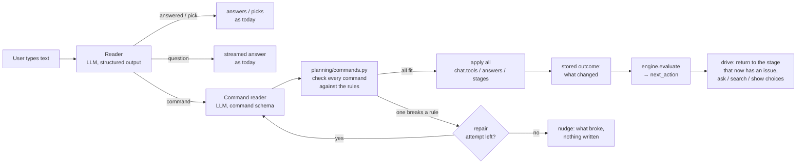
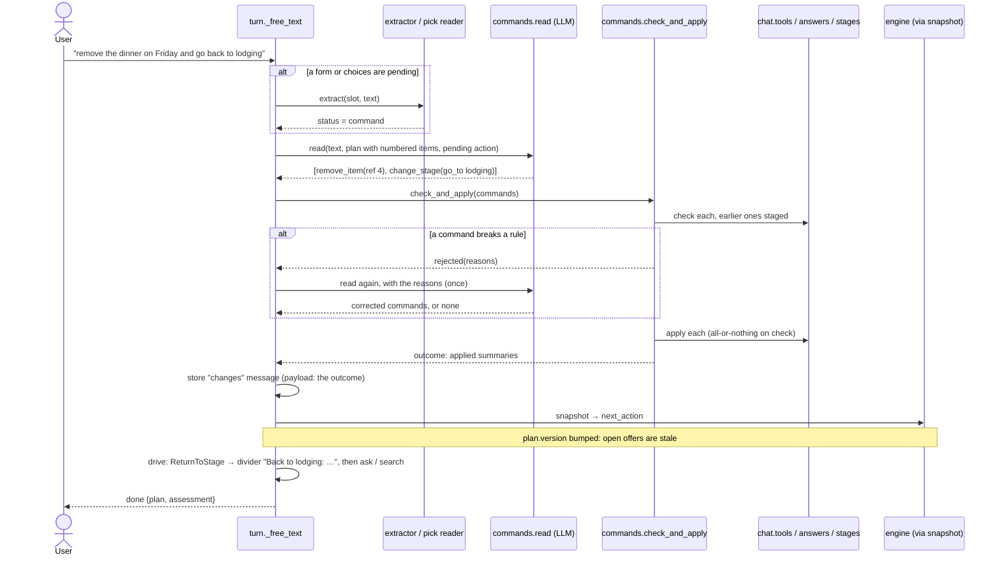

# Plan: Let the model change the plan through typed commands

How free text like "remove the Friday dinner" or "move the museum to Saturday morning" gets
to change the itinerary, without giving up what the planning flow is built on: **the model
never writes to the plan; it only translates text into typed data, and the rules decide**.

- [1. The problem today](#1-the-problem-today)
- [2. The shape of the change](#2-the-shape-of-the-change)
- [3. One command turn](#3-one-command-turn)
- [4. The command vocabulary](#4-the-command-vocabulary)
- [5. What the rules do with a command](#5-what-the-rules-do-with-a-command)
- [6. Pushing the user to the next state](#6-pushing-the-user-to-the-next-state)
- [7. Reading commands out of free text](#7-reading-commands-out-of-free-text)
- [8. The transcript and the UI](#8-the-transcript-and-the-ui)
- [9. Guardrails](#9-guardrails)
- [10. Phases](#10-phases)
- [11. Decisions made here, and the ones left open](#11-decisions-made-here-and-the-ones-left-open)

---

## 1. The problem today

Every planning turn starts from one of five triggers (`planning/turn.py`): a form answer,
a skip, a pick, free text, or Continue. Free text is read **only against the pending
question**: the extractor turns it into the pending slot's value, the pick reader turns it
into candidate ids, and when nothing is pending it is a question that gets a streamed answer
and changes nothing. There is no path from text to a write.

So "remove the dinner on Friday" while the planner is asking "Pick your flight home" is
`unrelated`, and the user gets the slot's fixed nudge. The only ways to change an item are
the item sheet (REST `PATCH` / `DELETE` on `/plans/{id}/items/...`) and picking.

The pieces to do it right already exist, they are just not connected:

| Already there | Where | What it gives us |
|---|---|---|
| Named plan changes with the plan rules (route, overnight, timezone, budget), check-then-apply, all-or-nothing staging | `chat/tools.py` (`check_change`, `apply_change`, `ProposedChange`) | the write path every pick already uses |
| Typed slot answers written through the same validation as a form | `planning/answers.py` (`parse_answer`, `apply_answer`) | plan-level changes (dates, travelers, budget, preferences) |
| Stage moves with their rules | `plans/stages.py` (`apply_stage_change`) | "go back to lodging", "skip flights" |
| A pure engine that reads the plan and says what is next | `planning/engine.py` (`evaluate`, `next_action`) | the next state after any change, for free |
| Offers that go stale on any plan change (`plan_version`) | `planning/offers.py`, `engine.offer_fits` | a changed plan searches again by itself |
| Structured-output extraction with a fail-closed guardrail | `planning/extractor.py` | the pattern for reading model output safely |

What is missing is a **command layer** between the model and those pieces, and one engine
rule so the workflow walks the user back to whatever a change broke.

## 2. The shape of the change



Responsibilities, in one line each:

- **The model** turns one message into zero or more typed commands, each pointing at an
  item or a slot *by a reference it was given in the prompt*. It never sees a UUID it has to
  spell, never invents an item, and never writes.
- **`planning/commands.py` (new)** owns the command vocabulary, resolves references, checks
  every command against the rules with the earlier ones staged, writes them all or none, and
  returns a typed outcome.
- **The rules** stay where they are: item rules in `chat/tools.py` and `itinerary/*`, plan
  rules in `planning/answers.py` and `plans/service.py`, stage rules in `plans/stages.py`.
- **The engine** (`planning/engine.py`) stays pure and reads the plan after the write. One new
  rule: if a stage before the current one now has a blocking issue, the next action is to go
  back to it.
- **The turn** (`planning/turn.py`) gets one more branch in `_free_text`, and the drive loop
  handles the new "go back" action with a divider.

Note on names: the user-facing word "rules engine" covers two modules here. `planning.engine`
decides *what comes next*; `chat.tools` decides *whether a change fits*. Both run on every
command. (`chat/tools.py` is misnamed since the chat agent was removed in `fb68f48`; moving
it to `planning/changes.py` is a safe follow-up, not part of this plan.)

## 3. One command turn



The visible result for the example in the request ("remove an activity"): the user's text,
then an assistant entry *"Removed “Dinner at Cervejaria Ramiro”."*, then whatever the
engine asks next. If that was the only activity, the activities checklist is empty again,
so the drive loop goes back to the activities stage with a divider and shows the open
activities offer (or searches, since the version changed).

## 4. The command vocabulary

A discriminated union in `planning/commands.py`, mirrored by the JSON schema the model is
constrained to (`inline_schema`, as the extractor does). Everything the model can say is in
this list; anything else is `unrelated`.

| Command | Fields | Becomes | Phase |
|---|---|---|---|
| `remove_item` | `item: ItemRef` | `ProposedChange("remove_item")` | 1 |
| `update_item` | `item: ItemRef`, `changes: ItemEdits` | `ProposedChange("update_item")` | 1 |
| `set_basics` | one of `dates`, `travelers`, `destination`, `origin`, `budget` (the slot value models) | `answers.apply_answer` | 1 |
| `set_preferences` | `flights` / `lodging` / `activities` (the preference models, partial) | `answers.apply_answer` | 2 |
| `change_stage` | `action: back | go_to | skip_flights`, `stage?` | `stages.apply_stage_change` → `plans_service.set_stage` | 1 |
| `redo_search` | `slot: SlotName`, `hint?: str` | dismiss the open offer for that slot; the engine's next action is then `RunSearch` | 2 |

Definitions:

- `ItemRef` is a **small integer**, the item's position in the numbered list the prompt
  shows (the same trick the pick reader uses with candidate ids "1", "2"). The server maps
  it back to the UUID; an out-of-range ref is a rejection, never a guess.
- `ItemEdits` is the subset of each item type's patch fields the model may touch: `start`,
  `end`, `title`, `notes`, `status` (`cancelled` is the soft remove). Not `cost`, not
  `from_place` / `to_place`, not airports: those come from searches. The server builds the
  real `*ItemPatch` and `chat.tools._prepare_update` re-runs the overnight, timezone, route
  and budget checks as it does for any update.
- There is **no `add_*` command**. Adding a flight, a stay, an activity or a transfer with
  details the model made up is exactly what the planning flow exists to prevent. "Add a
  museum visit" is read as `set_preferences(activities += museum)` plus `redo_search
  (activities)` in phase 2, and the user picks from real results.
- `set_basics` reuses the slot value models (`DatesAnswer`, `Travelers`, ...) so the same
  validators run ("can't start in the past", "end after start") and `describe_answer` gives
  the transcript line.

The reply schema around the list:

```json
{
  "status": "command" | "ambiguous" | "question" | "unrelated",
  "commands": [ ...up to 5... ],
  "clarification": "Which dinner: Friday's at X or Saturday's at Y?"   // ambiguous only
}
```

## 5. What the rules do with a command

`commands.check_and_apply(ctx, plan, commands) -> CommandOutcome`, modelled on
`picks.apply_pick`:

1. **Resolve**: every `ItemRef` to an item in `plan.items`; every `set_basics` value through
   `parse_answer`; every `change_stage` through `apply_stage_change` (dry: it is pure).
   A failure here is a rejection with the message for people.
2. **Check**: item commands become `ProposedChange`s and go through `tools.check_change`
   with the earlier ones staged (so "remove the hotel and move dinner" checks the move
   against the plan without the hotel). Plan-level commands are checked by their own
   validators. Nothing is written yet.
3. **Apply**: only when every command passed. Item changes through `tools.apply_change`,
   answers through `apply_answer`, the stage through `set_stage`. Each write bumps
   `plan.version`, so open offers retire (`engine.offer_fits`) and searches run again.
4. **Outcome**: `CommandOutcome(applied: list[AppliedCommand], rejected: list[Rejection])`,
   where each applied command carries the summary `chat.tools` already writes ("Removed
   “…”", "Change “…”: start, end") and each rejection the rule it broke.

Rejections go two places:

- **Back to the model, once.** The reader is called again with the user's message plus the
  rejection reasons ("Dinner can't move to 2027-05-02 19:30: that is during the flight home").
  This handles the cases a model can fix on its own (a time in the wrong zone, a date typo,
  an edit that needs the next day's date) and is the "indicate what rules are broken back to
  the LLM" step. Bounded to one repair, like `MAX_ATTEMPTS` in the extractor.
- **To the user**, when the repair didn't help or the model gave up: a `nudge` with the
  reasons, nothing written, and the engine drives as before (so the pending form or choices
  come back). Same pattern as a pick that doesn't fit.

Why not let the model also write the confirmation text? Because the summaries are already
there, they can't claim something that didn't happen, and it saves a model call per edit.
The outcome payload is structured, so a model-written reply can be layered on later if the
templated one reads too flat.

## 6. Pushing the user to the next state

The engine already does most of this. After a removal the checklist has a new issue, the
version bump retires the offer, and `next_action` asks to fix it. Two gaps:

**Gap 1: the engine only looks at the current stage (and basics).** At `ground` or `review`,
removing the only hotel leaves an `uncovered_night` in the lodging checklist, but
`next_action` returns the ground stage's work or `Complete`. The issue sits in the issues
flyout until the user clicks "Go to". Today that is reachable only through the item sheet;
with commands it becomes common.

New engine rule, in `next_action` right after the basics check:

> If any stage before the current one has fixable blocking issues, the next action is
> `ReturnToStage(to=<that stage>, reason=<its first issue's message>)`.

`ReturnToStage` is a new `NextAction` (or `AdvanceStage` generalised to `MoveStage` with a
`reason`; pick one when implementing, the former keeps the UI's existing handling of
`advance_stage` untouched). The drive loop applies it with `apply_stage_change(go_to)`,
stores a `stage` divider ("Back to lodging: a place to stay the night of May 2."), and
loops; the next pass asks or searches in that stage. This is deterministic and also fixes
the same gap for item-sheet edits. It is safe because `next` already refuses to leave a
stage with issues, so an earlier-stage issue can only ever come from an edit.

**Gap 2: nothing tells the user why the question changed.** The `changes` message
(section 8) and the divider's reason cover it.

## 7. Reading commands out of free text

Keep the existing readers; add a first-class way for them to say "this is an edit".

- **A form is pending** (`AskInput`): `extractor.extract` gets a fourth status, `command`,
  with no value. The per-slot schema grows by one enum member, so the extractor eval
  (`test_extractor_eval.py`) keeps its shape; add cases where edit requests must come back
  as `command`, not as an answer.
- **Choices are pending** (`OfferChoice`): the same fourth status on `PickReply`.
- **Nothing is pending** (a search to run, or review): today the text streams straight to
  the question answerer. Run the command reader first with the full schema above; `question`
  then streams the answer as today, so a question costs one extra small call only in this
  state.
- On `command` from either reader, call `commands.read(llm, text, plan, pending, today)`:
  one structured call, `think=False`, constrained to the command schema, two attempts on
  malformed JSON, failing closed to `unrelated` (the slot nudge, or "I can only change the
  trip through …" when nothing is pending).

The prompt (`prompts.command_messages`) shows: today's date, `trip_summary`, the pending
question if any, and the itinerary as a numbered list, one item per line (type, title, local
start–end, place, status), with the rule *"only use item numbers from the list; never add
items; when two could match, answer `ambiguous` and ask which"*.

The offline fake (`planning/offline.py`) gets a phrase table for commands so the Playwright
suite can run them: "remove the hotel" → `remove_item` of the first lodging item, "go back
to flights" → `change_stage`, "move dinner to saturday" → an `update_item` with a fixed time.

## 8. The transcript and the UI

- New `MessageKind.CHANGES` ("changes"), assistant role, content = the summaries joined
  ("Removed “X”. Changed “Y”: start, end."), payload `ChangesRecord {applied: [{name,
  summary, item_id?}], rejected: [{summary, reason}]}` added to `MessagePayload`.
- `MessageBubble` renders `changes` as a compact list card (one line per change, a check
  mark; rejections, if any, with the reason). No proposal buttons: there is nothing to
  approve, the words were the approval.
- `stage` dividers already render; a `ReturnToStage` divider reuses them.
- `plan_updated` events already refresh the timeline through `planCache`, so removed or
  moved items disappear and move live.
- `composerPlaceholder` gains the hint that edits work too ("…or ask me to change
  something").
- SDK regen (`backend/openapi.json`, `frontend/src/api/*.gen.ts`).

## 9. Guardrails

Carried over from the planning flow, plus a few for writes:

- The model's output is parsed by Pydantic against a closed union; unknown commands or
  fields are a malformed reply, retried once, then `unrelated`.
- Item references are list positions resolved server-side; no UUIDs from the model.
- No `add_*`. No `cost`, places or airports in `update_item`.
- All-or-nothing: one rejected command means nothing is written (check all, then apply all,
  as `apply_pick`).
- At most 5 commands per message.
- `ambiguous` is a first-class status that becomes a question back to the user, not a
  guess.
- Every write goes through the same validators the REST API and picks use; the model has no
  shortcut around budget, zone, route or overnight rules.
- Removals are soft where possible: `status = cancelled` keeps the item (and its cost out of
  the budget via `active()`), so "undo" is a later `update_item`. Hard `remove_item` stays
  available for items that were never real (a "proposed" the user dislikes); decide the
  default in phase 1 (see section 11).
- The command reader runs under the same per-user `limit_chat_messages` rate limit as free
  text, and `today` comes from the server.

## 10. Phases

Progress: phases 0 and 1 done; phases 2-4 not started.

Each phase lands green (`ruff`, `mypy`, `pytest`, frontend `lint` / `typecheck` / `test`),
with a check-in after each.

**Phase 0: the engine walks back to a broken stage** (independent; useful on its own)
**Done** (commit b998156, 2026-11-07). The stage bar shows a "Back to <stage>" button for
the new action instead of a plain "Continue", and the planning test fixtures reach later
stages legitimately through a shared `reach` helper.

- `planning/schemas.py`: `ReturnToStage` in `NextAction`.
- `planning/engine.py`: the earlier-stage rule in `next_action`; `evaluate` unchanged.
- `planning/turn.py::_drive`: handle it (go_to + divider + loop).
- Tests: `test_engine.py` (ground/review plan with an uncovered night → ReturnToStage;
  a plan whose earlier stages are clean → unchanged), a turn test through
  `planning_http.py`.
- Frontend: `StageBar` / `ContinuationCard` already key off `next_action.type`; make sure
  the new type falls through to "Continue" rather than an unknown-state render.
- Docs: Userflow.md section 6.

**Phase 1: the command layer, no model yet**
**Done** (2026-11-07). How it landed, where it differs from the sketch above:

- The command models (`Command`, `ItemEdits`, `ItemRef`, `MAX_COMMANDS`) live in
  `planning/schemas.py` with `ChangesRecord`, per the CLAUDE.md rule that Pydantic schemas
  go in `schemas.py`; `planning/commands.py` holds the logic (`numbered_items`,
  `check_and_apply`, `describe_changes`). `check_and_apply` returns the `ChangesRecord`
  itself rather than a separate `CommandOutcome`, since they had the same shape.
- `remove_item` cancels (open decision 1 below), so it becomes an `update_item` with
  `status: cancelled`. `chat.tools` now treats a staged cancellation like a staged
  removal in the route and zone checks, so "remove X, then move Y" checks Y without X.
- Two guardrails beyond section 9: a second command on the same item is rejected
  ("Change each item in one command"; a staged update isn't projected onto the item), and
  every command is checked even after one fails, so the repair pass sees every broken rule.
- `set_basics` summaries show the old value: "Dates: May 1, 2027 to May 8, 2027 → May 3,
  2027 to May 10, 2027" (open decision 2). `answers.describe_value` gives the bare value.
- `MessageKind.CHANGES` and `ChangesRecord` are in the spec and the regenerated SDK; the
  UI doesn't render them yet (phase 3).
- **For phase 2:** a `change_stage` back to a stage whose checklist is empty leaves the
  engine at `AdvanceStage`, which `_drive` acts on at once, so "go back to flights" on a
  finished flights stage would bounce straight forward again. The command turn has to
  stop the drive at that `AdvanceStage` (show the stage, offer Continue) instead.

- `planning/commands.py`: the command models, `ItemRef` resolution, `check_and_apply`,
  `CommandOutcome`, summaries. Phase-1 vocabulary: `remove_item`, `update_item`,
  `set_basics`, `change_stage`.
- `chat/schemas.py`: `MessageKind.CHANGES`; `planning/schemas.py`: `ChangesRecord` in
  `MessagePayload`.
- Tests: `tests/features/planning/test_commands.py` for resolution errors, staging (remove
  then move), all-or-nothing, each command's write, summaries.

**Phase 2: reading commands from text**

- `extractor.py`: `command` status on both readers; `commands.read` with its schema and
  attempts; `prompts.command_messages` with the numbered itinerary.
- `turn.py::_free_text`: the `command` branch for all three pending states, the single
  repair pass, the `changes` message, then `outcome.drive = True`.
- `offline.py`: command phrases.
- Tests: extractor status tests, `test_planning_offline.py`, turn tests for applied /
  rejected / ambiguous; eval cases in `test_extractor_eval.py` and a new
  `test_commands_eval.py` (`live_llm`) with ten or so edit phrasings per command.

**Phase 3: UI**

- SDK regen; `MessageBubble` `changes` card (own folder if it grows: `ChangesCard/`);
  `composerPlaceholder`; `PlanningPanelService` tests.
- E2E (`frontend/e2e/planning.spec.ts`): plan through to ground, type "remove the hotel",
  expect the changes card, the "Back to lodging" divider and the lodging choices.

**Phase 4: phase-2 vocabulary and docs**

- `set_preferences`, `redo_search` (dismiss the slot's open offer; `offers.close_offer
  (..., "dismissed")` exists).
- README "Planning flow" and Userflow.md sections 1, 2, 4: a new row in the free-text table
  ("an edit: remove, move, change the basics, go back") and the command turn diagram.

Rough size: phase 0 half a day; phase 1 a day; phase 2 a day plus the eval; phase 3 half a
day; phase 4 half a day.

## 11. Decisions made here, and the ones left open

Made in this plan (change them before phase 1 if you disagree):

- **Words are the approval.** A command the rules accept is written at once, as a pick is.
  No proposal card, no confirm step. The `changes` card and the live timeline make it
  visible; the next decision below keeps it reversible.
- **No model-created items.** Adds go through searches and picks only.
- **Deterministic confirmation text**, built from the change summaries. The model is told
  the broken rules only to repair a rejected command, once.
- **Two readers, not one.** The existing extractor/pick reader gains a `command` status and
  hands off to a dedicated command reader, instead of one big schema. Keeps the evaluated
  extractor schemas small (they also run on `qwen3:8b`) and the command prompt focused.
- **The walk-back is an engine rule**, not a command-turn special case, so item-sheet edits
  get it too.

Open, with a recommendation:

1. **Remove = delete or cancel?** *Decided in phase 1: cancel.* Recommend `remove_item` cancels (status `cancelled`) for
   items that came from a pick or the user, and hard-deletes nothing from the model. Cancelled
   items are already ignored by the checklists, gaps, budget and scheduler (`active()`), and
   the timeline can keep showing them struck through. Cheap undo, no new tables.
2. *Decided in phase 1: no confirmation, old → new summary.* **Should `set_basics` through a command re-trigger confirmation for big changes** (new
   dates retire every offer and may orphan flights)? Recommend no confirmation but a clear
   summary line ("Dates: May 1–8 → May 3–10. Flights and stays outside the new dates are
   flagged in Issues."); the engine's walk-back handles the rest.
3. **Where the write rules live.** Leave `chat/tools.py` in place for this work; rename to
   `planning/changes.py` in a follow-up commit once the command layer is stable.
