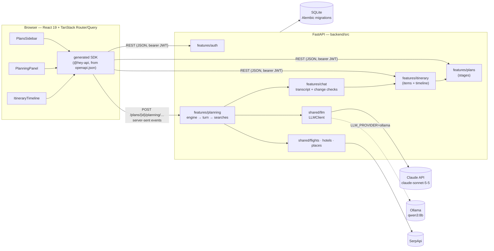

# Travel Planner

A trip planner that walks you through a trip stage by stage: basics, flights, lodging,
activities, transfers, review. A rules engine decides what to ask next from the plan itself,
real searches (flights, hotels, places) fill in the options, and picking an option is what
adds it to the itinerary shown as a timeline beside the transcript. The model (Claude Sonnet by
default, or a local Ollama model) only reads free text into the pending question and answers
short questions.

> Status: **Phase 6 of the planning-engine rewrite — complete.** Register/login (JWT), per-user
> trips, the itinerary API (flights / lodging / activities / transfers plus a derived
> day-by-day timeline with warnings), and the planning flow: typed forms, rule-ranked choices
> and auto-advancing stages, streamed over SSE into a planning panel whose picks show up live
> on the timeline. The old free-form chat agent and its proposal cards are gone. Alembic
> migrations, rate limits and request caps, and a full-stack Playwright suite round it off.

## Architecture



One planning turn: the user answers the pending form, picks from the pending choices, types
free text, or presses Continue → the answer or pick is stored and written to the plan (a pick
is validated by the same rules as any other change, and picking **is** the approval) → the
turn **drives** the engine, `{snapshot → evaluate → act}`, until it needs the user again:
it advances a finished stage (or goes back to an earlier one that a change broke), runs
the next search, and stops at the next form, the next choices, or the end of the trip. Each stored message streams as an event, and every plan
change emits `plan_updated` (the UI writes it into its query cache, so the timeline redraws
while the turn is still running). See [Userflow.md](Userflow.md) for every decision along
the way.

## Layout

```
backend/    FastAPI + SQLAlchemy (async) + Pydantic v2, managed with uv
  src/        import root: main.py, shared/, features/<name>/
  tests/      pytest (asyncio)
  migrations/ Alembic (alembic.ini next to it)
  scripts/    export_openapi.py, e2e_server.py
frontend/   Vite + React 19 + TypeScript (strict) + Tailwind v4 + shadcn/ui
  src/api/  generated by @hey-api/openapi-ts — do not hand-edit
  e2e/      Playwright
scripts/dev.sh    starts Ollama (if LLM_PROVIDER=ollama), backend, frontend
.vscode/          Start/Debug launch configs for backend + UI
```

## Prerequisites

- [uv](https://docs.astral.sh/uv/) (Python 3.13 is installed automatically)
- Node.js 24+
- bash (on Windows: Git Bash — the scripts and docs assume it; `.vscode/settings.json` makes it the
  default VS Code terminal)
- A Claude API key from [console.anthropic.com](https://console.anthropic.com), set as
  `ANTHROPIC_API_KEY` in `.env` (or, for a local model instead, [Ollama](https://ollama.com) with
  `qwen3:8b` and `LLM_PROVIDER=ollama`; the dev script pulls the model on first run)

## Setup

```bash
cp .env.example .env               # then set ANTHROPIC_API_KEY (and SERPAPI_API_KEY)
(cd backend && uv sync)
(cd frontend && npm install && npx playwright install chromium)
```

## Run

```bash
./scripts/dev.sh                    # backend :8000 + frontend :5173 (+ Ollama check if selected)
./scripts/dev.sh --model llama3.1:8b  # with LLM_PROVIDER=ollama
```

Ctrl+C stops both servers. Or individually:

```bash
(cd backend && uv run uvicorn main:app --app-dir src --reload)
(cd frontend && npm run dev)
```

In VS Code, the Run and Debug view has (`.vscode/launch.json`, needs `uv sync` first):

| Configuration | What it does |
|---|---|
| Backend: Start | uvicorn with `--reload`, no debugger |
| Backend: Debug | uvicorn under debugpy; no `--reload` so breakpoints stay attached (restart after edits) |
| UI: Start | `npm run dev`, no debugger |
| UI: Debug | starts Vite, then opens Chrome with the debugger attached to `frontend/src` |
| Full Stack: Start / Debug | both together; stopping one stops both |

## Checks

| | Backend (`backend/`) | Frontend (`frontend/`) |
|---|---|---|
| Lint | `uv run ruff check --fix .` | `npm run lint` |
| Format | `uv run ruff format .` | `npm run format` |
| Types | `uv run mypy src tests scripts migrations` | `npm run typecheck` |
| Unit tests | `uv run pytest` | `npm test` |
| E2E (full stack) | — | `npm run e2e` |
| Model eval (real model) | `uv run pytest -m live_llm -s` | — |

`npm run e2e` starts its own backend and frontend on separate ports (API `:8765`, UI `:5174`), so it
never touches a running dev stack: `backend/scripts/e2e_server.py` runs the API with
`LLM_PROVIDER=fake`, fake flight, hotel and place searches, and a fresh `backend/e2e.db`. The
specs in `frontend/e2e/` cover sign-up / sign-in and walk a trip through every stage with forms
and picks, plus free text read into a form, a nudge, a question, Skip flights and going back.

`uv run pytest -m live_llm -s` runs the tests left out by default, against the model `.env`
selects (on Claude these are real, billed API calls):
`tests/features/planning/test_extractor_eval.py` reads hand-written free text for dates,
travelers and places (and questions or off-topic text, which must not be read as answers) and
asserts a pass rate, printing the misses. Run it after changing `planning/prompts.py`, a slot's
value model, or the model.

## Data & auth

- SQLite via SQLAlchemy (async), `DATABASE_URL` (default `backend/travel_planner.db`). The app runs
  **Alembic migrations on startup** (`alembic upgrade head`), so there's nothing to do after
  pulling. A database created before migrations existed is detected (tables but no
  `alembic_version`) and stamped at the baseline revision, keeping its data.
- After changing an ORM model, add a migration and review it:

  ```bash
  cd backend
  uv run alembic revision --autogenerate -m "add plan currency"
  uv run alembic upgrade head      # or just restart the app
  ```

  `tests/shared/test_migrations.py` fails if the models and migrations drift apart. Migrations
  use batch mode, since SQLite can't `ALTER` most columns in place.
- `POST /auth/register` / `POST /auth/login` return a bearer JWT; set a long random `JWT_SECRET`
  outside local dev. The frontend keeps the token in memory + `localStorage` (`src/lib/auth.ts`) and
  the generated SDK attaches it to every secured call.

## Itinerary

- Items are a discriminated union on `type`: `flight`, `lodging` (start = check-in, end = check-out),
  `activity`, `transfer`. CRUD under `/plans/{plan_id}/items`; every change bumps the plan
  `version`. `GET /plans/{id}` returns the plan with its `items` sorted by start.
- Times are stored as UTC and returned in the item's IANA `timezone` (`end` in `end_timezone`
  when set, e.g. a flight's arrival airport). Naive input times are read as wall-clock time there.
- `GET /plans/{id}/timeline` derives local-day columns, one lodging bar per stay, and warnings
  (nights without lodging, overlaps, missing transfers between places, items outside the trip
  dates, items in another timezone than the traveller is in). The logic is pure and lives in
  `features/itinerary/timeline.py`.
- Each timeline day carries the `timezone` the traveller ends it in, worked out from the
  flights and transfers (`features/itinerary/zones.py`). The change checks
  (`features/chat/tools.py`) refuse a pick whose hotel, activity or transfer is in another
  timezone (e.g. a Tokyo dinner in New York time), breaks the flight route, isn't an overnight
  stay, or goes over the budget or a spending limit.

## Hardening

| | Default | Setting |
|---|---|---|
| Free-text / continue turns per user | 20 / minute | `CHAT_RATE_LIMIT_PER_MINUTE` |
| Login + register attempts per IP | 10 / minute | `AUTH_RATE_LIMIT_PER_MINUTE` |
| Request body | 64 KB | `MAX_REQUEST_BYTES` |
| Free-text message | 4000 characters | `MAX_MESSAGE_CHARS` in `features/chat/schemas.py` |

- Over a rate limit: `429` with a `Retry-After` header and a readable `detail`, which the UI shows
  as-is. Limits are kept in memory per process (`shared/rate_limit.py`); a multi-worker deployment
  would need a shared store behind the same `RateLimiter` interface. Set a limit to `0` to turn it
  off.
- All text fields have length caps in their Pydantic schemas; oversized bodies get `413`.
- CORS allows only `CORS_ORIGINS`, the methods the API uses, and the `Authorization` /
  `Content-Type` headers, without credentials (auth is a bearer header, not a cookie).
- `ENVIRONMENT=production` refuses to start with the default or a short `JWT_SECRET`, or with `*`
  in `CORS_ORIGINS`.

## Planning flow & searches

- Routes, under `/plans/{id}/planning`: `GET /messages` (the transcript, each message with the
  form, choices or answer it showed), and three SSE routes that end in `done` (with the plan and
  its assessment) or `error`. `POST /inputs` takes a form answer, a skip, or a pick, with **no
  model call**: `409` if it isn't what is being asked, `422` if the value doesn't fit.
  `POST /chat` takes free text. `POST /continue` drives with no input (the "Find flights" /
  "Retry" button); with `{"refresh": true}` it searches the pending choices again for ones not
  offered yet (the "More options" button; transfers come from rules and list every way at once,
  so they have none).
- The engine (`features/planning/engine.py`, pure) reads only the plan: each stage has an
  ordered list of slots (`planning/slots.py`), and the first unfilled one wins. A finished
  stage advances by itself, and a stage whose checklist breaks again after a later change
  (a stay deleted at review) is returned to by itself; Back and the stepper's earlier steps
  stay available, later ones are locked. `GET /plans/{id}` carries the verdict as `assessment` (stage, issues, next
  action).
- Choices come from searches (`planning/searches.py`), kept as an **offer** (`planning_offers`)
  so a reload never searches again. Each candidate carries its ready-made changes; picking
  checks all of them first (`features/chat/tools.py`: route, overnight, timezone, budget), then
  writes them, so a pick that doesn't fit changes nothing and says why.
- The model makes three kinds of call and nothing else: the **extractor**
  (`planning/extractor.py`) reads free text into the pending slot's schema, or into a pick
  ("the second one"), with a JSON-schema `format` (Claude's structured outputs, or Ollama's
  `format`) and two attempts; the reply is
  validated with Pydantic, and anything else gets the slot's fixed nudge. The **command
  reader** turns an edit ("remove the Friday dinner", "go back to lodging", "somewhere
  cheaper") into typed commands from a closed list, pointing at items by their number in
  the itinerary it was shown. It never writes: `planning/commands.py` checks every command
  against the same rules as a pick or the item sheet and writes them all or none, and the
  rules a command breaks go back to the reader once to repair. A question gets a short
  streamed **answer**, which is shown and stored but never parsed. No reply text is ever
  matched with regexes.
- `LLM_PROVIDER=fake` runs without a model (`planning/offline.py`): free text is read from a
  small phrase table per slot ("two adults", "next month for a week", "the second one"),
  plus a few edits ("remove the hotel", "go back to lodging", "show me other options",
  "make the hotel upscale"); questions get a fixed answer, and anything else is nudged.
- Flight search uses Google Flights results from [SerpApi](https://serpapi.com): set
  `SERPAPI_API_KEY` (250 free searches a month; a round trip takes two). Results are
  structured, so flight times are copied from the search, never written by the model.
  Each time is the airport's local time, made aware with the airport's IANA zone from the
  `airportsdata` package (`backend/src/shared/flights/`). The key travels in the request
  URL, so httpx's request logs are redacted (`shared/logging.py`). `FLIGHT_PROVIDER=fake`
  makes up flights with no network access; tests and E2E always use it.
- The planner's lodging stage searches Google Hotels through the same SerpApi key
  (`backend/src/shared/hotels/`), one search per run of nights without a place to stay.
  `HOTEL_PROVIDER=fake` makes up places to stay; tests and E2E always use it.
- The activities stage searches Google Maps through the same key (`backend/src/shared/places/`),
  one search per interest, run together. The places are ranked and scheduled into the trip's
  free time by rules (`features/planning/scheduler.py`). `PLACES_PROVIDER=fake` makes up
  museums and restaurants; tests and E2E always use it. Transfers between places need no
  search: their ways, times and price estimates come from rules alone
  (`features/planning/transfer_search.py`). That includes cars: your own car (only on trips
  without flights), and a rental car that, once picked up, is offered first for every later
  ride until a flight leaves it behind.

## Swapping the model

The model is picked in `.env`; nothing else changes. Restart the backend after editing it.

```bash
LLM_PROVIDER=anthropic              # Claude (default); needs ANTHROPIC_API_KEY
ANTHROPIC_MODEL=claude-sonnet-5-5   # or claude-opus-5-5, claude-haiku-5-5, ...

LLM_PROVIDER=ollama                 # a local model instead
OLLAMA_MODEL=qwen3:8b               # or: ./scripts/dev.sh --model llama3.1:8b

LLM_PROVIDER=fake                   # no model: scripted replies (tests, E2E)
```

- The model needs **structured outputs** (a JSON-schema `format`); it is never offered tools.
  The startup log line shows the provider and model in use.
- **Claude** (`backend/src/shared/llm/anthropic_client.py`): extraction runs at low effort and
  answers stream. `LLM_THINK=true` raises effort to high (more thorough, slower).
  `ANTHROPIC_MAX_TOKENS` (default 16000) caps each reply, thinking included.
  `ANTHROPIC_REFUSAL_FALLBACK=true` (default) has the API re-run a request that Claude's safety
  filters decline on a fallback model. Rate limits, overloads and network errors are retried by
  the SDK (`LLM_MAX_ATTEMPTS`, `LLM_TIMEOUT_SECONDS`). Without a key the app still starts, and
  each planning turn says the key is missing.
- **Ollama**: `qwen3:8b` (the default) is the local model the flow was built against;
  `llama3.1:8b` is the intended fallback. `LLM_THINK=true` turns on reasoning for models that
  support it (slower to first token). `OLLAMA_URL` points at a remote Ollama.
  `LLM_CONTEXT_TOKENS` (default 16384) sets the model's context window; lower it if the model
  doesn't fit in VRAM. `LLM_MAX_OUTPUT_TOKENS` (default 2048) caps each reply.
- Extraction schemas are trimmed for the prompt (`backend/src/shared/llm/schema.py`). Set the
  `shared.llm` loggers to DEBUG to see token counts per call.
- **Another backend** (llama.cpp server, vLLM, another hosted API): implement the `LLMClient`
  protocol in `backend/src/shared/llm/types.py` (`chat`, `stream`, `aclose`, raising `LLMError`
  with a user-safe message), add a value to `Settings.llm_provider`, and return your client from
  `create_llm` in `backend/src/features/chat/dependencies.py`. `AnthropicClient` and
  `OllamaClient` are the references.

## Frontend

- **Planning** (`components/PlanningPanel`): the transcript from
  `GET /plans/{id}/planning/messages` plus the live turn, with the pending form
  (`ExpectedInputPanel`, built from the slot's field specs) or choices (`ChoiceList` /
  `CandidateCard`) under it, and the stage bar (`StageBar`: Back, Skip flights, Find… / Retry).
  `lib/sse.ts` streams the three turn routes through the generated SDK's SSE client (never
  retried, since a retry would store the input twice) and narrows each event on `type`;
  `lib/planningTurn.ts` folds the events into the turn.
- **Issues** (`components/IssuesPanel`, at the end of the stage stepper): the planner's
  blocking issues and timeline warnings, each with "Go to" the stage that fixes it.
- **Live itinerary**: each `plan_updated` event is written into the plan query cache and
  invalidates the timeline (`lib/planCache.ts`), so the right-hand panel updates mid-turn.
- **Timeline** (`components/ItineraryTimeline`): one column per day on a half-column CSS grid.
  Stays are drawn from mid check-in day to mid check-out day, so back-to-back stays share a lane
  (`layoutLodging` in `lib/timeline.ts`). Times show in each place's local time, read straight from
  the ISO offset, never converted to the viewer's timezone. Click any item for the detail sheet.
- **Theme**: sand / terracotta / deep-teal tokens and per-item-type colors in `src/index.css`,
  Fraunces for headings, light/dark toggle in the header (`lib/theme.ts`).

## API client generation

The frontend SDK is generated from the backend's OpenAPI spec. After changing any backend route or
schema:

```bash
(cd frontend && npm run gen)   # exports backend/openapi.json, then regenerates src/api
```
