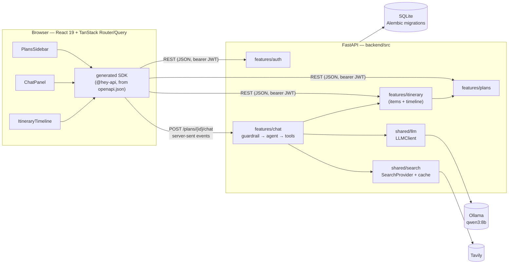

# Travel Planner

A travel-itinerary chat app. Every message goes to a small local model (Ollama), which checks the
message is about trip planning, gently redirects if not, and otherwise acts as an agent that can
search the web and edit a structured itinerary shown as a timeline beside the chat.

> Status: **Phase 6 — complete.** Register/login (JWT), per-user trips, the itinerary API
> (flights / lodging / activities / transfers plus a derived day-by-day timeline with warnings),
> and the chat: topic guardrail, planning agent with itinerary tools and cached web search,
> streamed over SSE into a chat panel whose edits show up live on the timeline. Alembic
> migrations, rate limits and request caps, and a full-stack Playwright suite round it off.

## Architecture



One chat message: the user message is stored → the **guardrail** (one structured-output call)
decides whether it's about trip planning → off-topic messages get a short **redirect** with no
tools → on-topic ones go to the **agent**, which streams tokens and calls tools
(`add_activity`, `web_search`, …) for up to 6 rounds. Every itinerary change emits a
`plan_updated` event with the full plan, which the UI writes into its query cache, so the
timeline redraws while the reply is still streaming.

## Layout

```
backend/    FastAPI + SQLAlchemy (async) + Pydantic v2, managed with uv
  src/        import root: main.py, shared/, features/<name>/
  tests/      pytest (asyncio)
  migrations/ Alembic (alembic.ini next to it)
  scripts/    export_openapi.py, e2e_server.py
frontend/   Vite + React 19 + TypeScript (strict) + Tailwind v4 + shadcn/ui
  src/api/  generated by @hey-api/openapi-ts — do not hand-edit
  e2e/      Playwright
scripts/dev.sh    starts Ollama (if needed), backend, frontend
.vscode/          Start/Debug launch configs for backend + UI
```

## Prerequisites

- [uv](https://docs.astral.sh/uv/) (Python 3.13 is installed automatically)
- Node.js 24+
- bash (on Windows: Git Bash — the scripts and docs assume it; `.vscode/settings.json` makes it the
  default VS Code terminal)
- [Ollama](https://ollama.com) with `qwen3:8b` (the dev script pulls it on first run)

## Setup

```bash
cp .env.example .env
(cd backend && uv sync)
(cd frontend && npm install && npx playwright install chromium)
```

## Run

```bash
./scripts/dev.sh                    # Ollama check + backend :8000 + frontend :5173
./scripts/dev.sh --skip-ollama      # without the model
./scripts/dev.sh --model llama3.1:8b
```

Ctrl+C stops both servers. Or individually:

```bash
(cd backend && uv run uvicorn main:app --app-dir src --reload)
(cd frontend && npm run dev)
```

In VS Code, the Run and Debug view has (`.vscode/launch.json`, needs `uv sync` first):

| Configuration | What it does |
|---|---|
| Backend: Start | uvicorn with `--reload`, no debugger |
| Backend: Debug | uvicorn under debugpy; no `--reload` so breakpoints stay attached (restart after edits) |
| UI: Start | `npm run dev`, no debugger |
| UI: Debug | starts Vite, then opens Chrome with the debugger attached to `frontend/src` |
| Full Stack: Start / Debug | both together; stopping one stops both |

## Checks

| | Backend (`backend/`) | Frontend (`frontend/`) |
|---|---|---|
| Lint | `uv run ruff check --fix .` | `npm run lint` |
| Format | `uv run ruff format .` | `npm run format` |
| Types | `uv run mypy src tests scripts migrations` | `npm run typecheck` |
| Unit tests | `uv run pytest` | `npm test` |
| E2E (full stack) | — | `npm run e2e` |
| Real-model tests | `uv run pytest -m ollama` | — |

`npm run e2e` starts its own backend and frontend on separate ports (API `:8765`, UI `:5174`), so it
never touches a running dev stack: `backend/scripts/e2e_server.py` runs the API with
`LLM_PROVIDER=fake`, `SEARCH_PROVIDER=fake` and a fresh `backend/e2e.db`. The specs in
`frontend/e2e/` cover sign-up / sign-in, sending a chat message that adds an item which then
appears on the timeline (and opens in the detail sheet), and the off-topic redirect.

## Data & auth

- SQLite via SQLAlchemy (async), `DATABASE_URL` (default `backend/travel_planner.db`). The app runs
  **Alembic migrations on startup** (`alembic upgrade head`), so there's nothing to do after
  pulling. A database created before migrations existed is detected (tables but no
  `alembic_version`) and stamped at the baseline revision, keeping its data.
- After changing an ORM model, add a migration and review it:

  ```bash
  cd backend
  uv run alembic revision --autogenerate -m "add plan currency"
  uv run alembic upgrade head      # or just restart the app
  ```

  `tests/shared/test_migrations.py` fails if the models and migrations drift apart. Migrations
  use batch mode, since SQLite can't `ALTER` most columns in place.
- `POST /auth/register` / `POST /auth/login` return a bearer JWT; set a long random `JWT_SECRET`
  outside local dev. The frontend keeps the token in memory + `localStorage` (`src/lib/auth.ts`) and
  the generated SDK attaches it to every secured call.

## Itinerary

- Items are a discriminated union on `type`: `flight`, `lodging` (start = check-in, end = check-out),
  `activity`, `transfer`. CRUD under `/plans/{plan_id}/items`; every change bumps the plan
  `version`. `GET /plans/{id}` returns the plan with its `items` sorted by start.
- Times are stored as UTC and returned in the item's IANA `timezone` (`end` in `end_timezone`
  when set, e.g. a flight's arrival airport). Naive input times are read as wall-clock time there.
- `GET /plans/{id}/timeline` derives local-day columns, one lodging bar per stay, and warnings
  (nights without lodging, overlaps, missing transfers between places, items outside the trip
  dates). The logic is pure and lives in `features/itinerary/timeline.py`.

## Hardening

| | Default | Setting |
|---|---|---|
| Chat messages per user | 20 / minute | `CHAT_RATE_LIMIT_PER_MINUTE` |
| Login + register attempts per IP | 10 / minute | `AUTH_RATE_LIMIT_PER_MINUTE` |
| Request body | 64 KB | `MAX_REQUEST_BYTES` |
| Chat message | 4000 characters | `MAX_MESSAGE_CHARS` in `features/chat/schemas.py` |

- Over a rate limit: `429` with a `Retry-After` header and a readable `detail`, which the UI shows
  as-is. Limits are kept in memory per process (`shared/rate_limit.py`); a multi-worker deployment
  would need a shared store behind the same `RateLimiter` interface. Set a limit to `0` to turn it
  off.
- All text fields have length caps in their Pydantic schemas; oversized bodies get `413`.
- CORS allows only `CORS_ORIGINS`, the methods the API uses, and the `Authorization` /
  `Content-Type` headers, without credentials (auth is a bearer header, not a cookie).
- `ENVIRONMENT=production` refuses to start with the default or a short `JWT_SECRET`, or with `*`
  in `CORS_ORIGINS`.

## Chat & web search

- `POST /plans/{id}/chat` streams server-sent events. Each message goes through a topic guardrail
  (off-topic messages get a friendly redirect), then the planning agent, which edits the itinerary
  with tools (`set_plan_details`, `add_flight` / `add_lodging` / `add_activity` / `add_transfer`,
  `update_item`, `remove_item`) and looks things up with `web_search`.
- `LLM_PROVIDER=fake` runs without Ollama: a keyword guardrail and canned replies, plus one
  scripted command, so you can see a full tool round trip offline: "Add a visit to the Louvre"
  makes the fake agent call `add_activity` (`backend/src/features/chat/offline.py`).
- `web_search` uses [Tavily](https://tavily.com): set `TAVILY_API_KEY`. Without a key the tool
  reports that search is unavailable and the agent answers from general knowledge.
  `SEARCH_PROVIDER=fake` returns placeholder results with no network access.
- Short queries are filled in from the plan (`backend/src/shared/search/query.py`), e.g. "cheap"
  with kind `flights` becomes "cheap flights from San Francisco to Tokyo May 2027". Results are
  cached in the `search_cache` table for `SEARCH_CACHE_TTL_HOURS` (default 24).

## Swapping the model

The model is picked by settings; nothing else changes:

```bash
OLLAMA_MODEL=llama3.1:8b ./scripts/dev.sh      # or: ./scripts/dev.sh --model llama3.1:8b
```

- The same model runs the guardrail and the agent, so it needs **tool calling** and
  **structured outputs** (JSON-schema `format`). `qwen3:8b` (the default) is the model the
  real-model tests were run with; `llama3.1:8b` is the intended fallback. Before trying a model,
  check that `ollama show <model>` lists `tools` under its capabilities.
- `LLM_THINK=true` turns on reasoning for models that support it (slower to first token).
  `LLM_TIMEOUT_SECONDS` / `LLM_MAX_ATTEMPTS` tune retries; `OLLAMA_URL` points at a remote Ollama.
- `LLM_CONTEXT_TOKENS` (default 16384) sets the model's context window; Ollama's own default
  (4096) overflows once search results are in the prompt. Lower it if the model doesn't fit in
  VRAM. `LLM_MAX_OUTPUT_TOKENS` (default 2048) caps each reply. Tool schemas are trimmed for the
  prompt (`backend/src/shared/llm/schema.py`, plus hidden fields in `features/chat/tools.py`) to
  ~1.6k tokens, so `LLM_CONTEXT_TOKENS=8192` is a workable floor on small GPUs. Set the
  `shared.llm.ollama_client` logger to DEBUG to see prompt/output token counts per round.
- `uv run pytest -m ollama` runs the real-model tests against whatever `OLLAMA_MODEL` is set to;
  it's the quickest way to see whether a new model follows the tool schemas.
- **Another backend** (llama.cpp server, vLLM, a hosted API): implement the `LLMClient` protocol
  in `backend/src/shared/llm/types.py` (`chat`, `stream`, `aclose`, raising `LLMError` with a
  user-safe message), add a value to `Settings.llm_provider`, and return your client from
  `create_llm` in `backend/src/features/chat/dependencies.py`. `OllamaClient` is the reference.

## Swapping the search provider

- Built in: `SEARCH_PROVIDER=tavily` (needs `TAVILY_API_KEY`) or `fake` (no network).
- **Another provider** (Brave, SearXNG, …): implement the `SearchProvider` protocol in
  `backend/src/shared/search/types.py` (`search(query, kind, *, max_results)` returning
  `SearchResult`s, raising `SearchError` on failure; `aclose`), add a value to
  `Settings.search_provider`, and return it from `create_search_provider` in
  `backend/src/shared/search/provider.py`. Caching and query shaping wrap every provider, so
  there's nothing else to wire. `TavilyProvider` (`tavily.py`) shows the retry/timeout pattern.

## Frontend

- **Chat** (`components/ChatPanel`): history from `GET /plans/{id}/messages` plus the live turn.
  `lib/sse.ts` streams `POST /plans/{id}/chat` through the generated SDK's SSE client (never
  retried, since a retry would store the message twice) and narrows each event on `type`;
  `lib/chatTurn.ts` folds the events into the turn (tokens, tool chips, redirect, error).
- **Live itinerary**: each `plan_updated` event is written into the plan query cache and
  invalidates the timeline (`lib/planCache.ts`), so the right-hand panel updates as the agent works.
- **Timeline** (`components/ItineraryTimeline`): one column per day on a half-column CSS grid.
  Stays are drawn from mid check-in day to mid check-out day, so back-to-back stays share a lane
  (`layoutLodging` in `lib/timeline.ts`). Times show in each place's local time, read straight from
  the ISO offset, never converted to the viewer's timezone. Click any item for the detail sheet.
- **Theme**: sand / terracotta / deep-teal tokens and per-item-type colors in `src/index.css`,
  Fraunces for headings, light/dark toggle in the header (`lib/theme.ts`).

## API client generation

The frontend SDK is generated from the backend's OpenAPI spec. After changing any backend route or
schema:

```bash
(cd frontend && npm run gen)   # exports backend/openapi.json, then regenerates src/api
```
