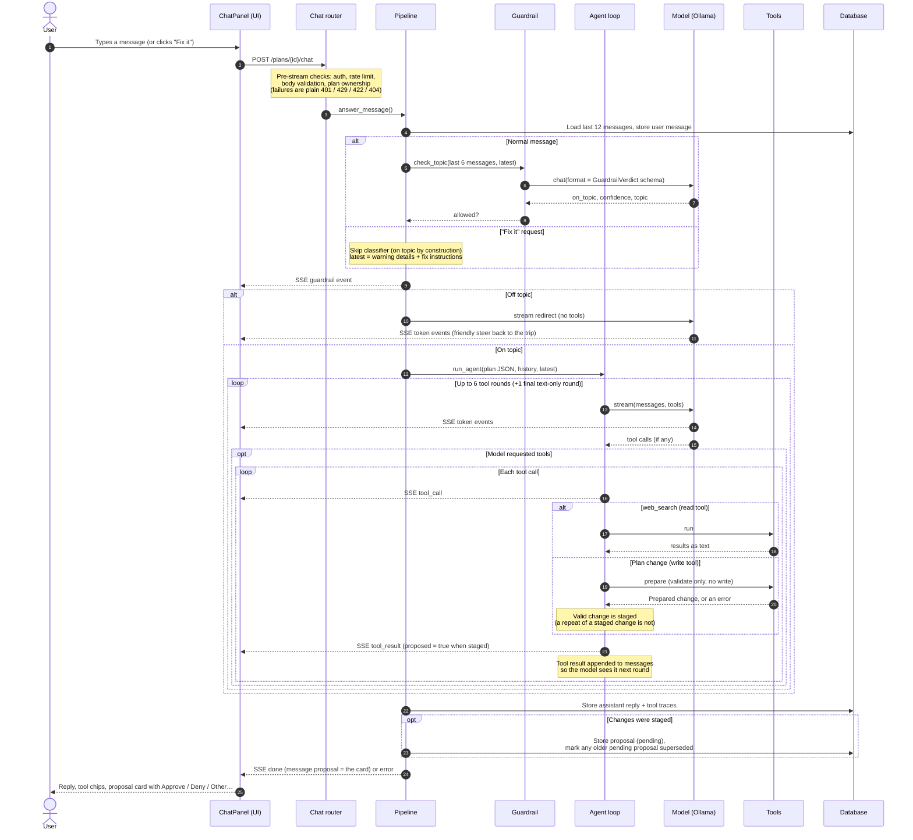
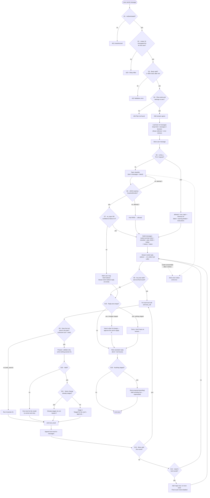
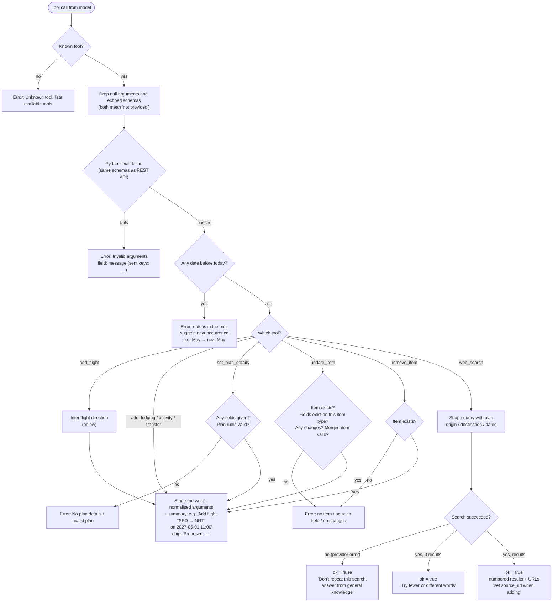
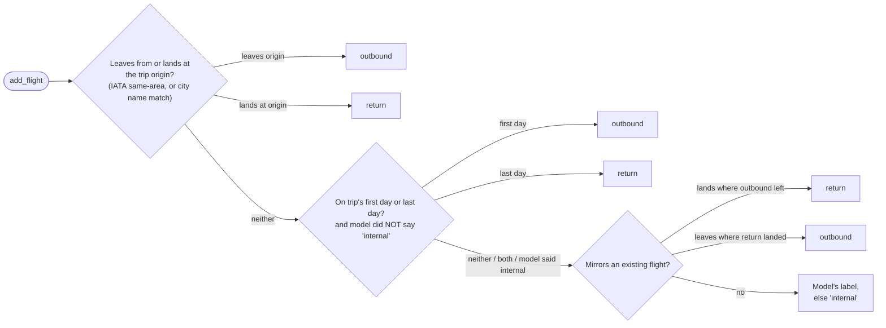

# User Flow: Chat → Guardrail → Agent → Proposal → Approval

How one chat message travels through the app, from the user's point of view, and every
check that decides what happens to it along the way. The short version: the assistant
never changes the trip on its own. Every change it wants to make is **staged** into a
proposal card, and nothing is written until the user picks **Approve**.

- [1. The big picture (sequence)](#1-the-big-picture-sequence)
- [2. Every decision in one turn (flowchart)](#2-every-decision-in-one-turn-flowchart)
- [3. Decision logic reference](#3-decision-logic-reference)
- [4. Approve / Deny / Other](#4-approve--deny--other)
- [5. Inside a tool call](#5-inside-a-tool-call)
- [6. What the user sees](#6-what-the-user-sees)

Source of truth: [router.py](backend/src/features/chat/router.py),
[pipeline.py](backend/src/features/chat/pipeline.py),
[guardrail.py](backend/src/features/chat/guardrail.py),
[agent.py](backend/src/features/chat/agent.py),
[tools.py](backend/src/features/chat/tools.py),
[prompts.py](backend/src/features/chat/prompts.py),
[service.py](backend/src/features/chat/service.py),
[chatTurn.ts](frontend/src/lib/chatTurn.ts),
[ProposalCard.tsx](frontend/src/components/ProposalCard/ProposalCard.tsx).

---

## 1. The big picture (sequence)

The same local model plays two roles: **topic classifier** (structured JSON-schema output)
and **planning agent** (streams text and tool calls). Write tools only validate during a
turn; the changes they stage are stored as one proposal on the assistant's reply.



The user's answer to the card is a second request; see [section 4](#4-approve--deny--other).

---

## 2. Every decision in one turn (flowchart)

Diamonds are decisions. The label on each diamond is the actual rule in code. Tags like
**D3** match the rows in [section 3](#3-decision-logic-reference).



---

## 3. Decision logic reference

| # | Decision | Logic | If it fails | Where |
|---|----------|-------|-------------|-------|
| D1 | Authenticated | `CurrentUser` dependency resolves the session user | `401` before the stream opens | [router.py](backend/src/features/chat/router.py) |
| D2 | Rate limit | Sliding 60 s window per user id, default **20** messages/min (`chat_rate_limit_per_minute`, 0 = off). Messages and card decisions share the budget. Rejected hits aren't counted. | `429` with `Retry-After` seconds | [rate_limit.py](backend/src/shared/rate_limit.py), [dependencies.py](backend/src/features/chat/dependencies.py) |
| D3 | Body valid | `content` trimmed, 1–4000 chars. Optional `fix` = a `TimelineWarning` | `422` | [schemas.py](backend/src/features/chat/schemas.py) |
| D4 | Plan ownership | `plans_service.get_plan(user_id, plan_id)` | `404` (checked before streaming so it's a normal HTTP error) | [router.py](backend/src/features/chat/router.py) |
| D5 | Fix request? | `body.fix is not None` → skip the classifier and wrap the message with the warning + fix instructions. The agent has every tool, so it proposes the fix on a card (or asks which of 2-3 fixes the user wants). | n/a | [pipeline.py](backend/src/features/chat/pipeline.py), [prompts.py](backend/src/features/chat/prompts.py) |
| D6 | Classifier output valid | `GuardrailVerdict.model_validate_json(reply)`; up to **2** attempts | **Fail open**: allow the message (a wrong redirect is worse than an occasional off-topic answer) | [guardrail.py](backend/src/features/chat/guardrail.py) |
| D7 | On topic | `allowed = on_topic or confidence < 0.5`. Greetings, thanks and follow-ups like "yes please" count as on topic. | Redirect: user message re-tagged `kind=redirect` so it never enters future agent context, and the model writes 1–2 sentences steering back to the trip | [guardrail.py](backend/src/features/chat/guardrail.py), [prompts.py](backend/src/features/chat/prompts.py) |
| D8 | Keep looping | Continue while the model returns tool calls and the round isn't the final one | Return: the turn's text is the answer | [agent.py](backend/src/features/chat/agent.py) |
| D9 | Write tool? | `changes_plan(name)`: true for every tool except `web_search` (a `ReadTool`); an **unknown** tool name also counts as a write | n/a | [tools.py](backend/src/features/chat/tools.py) |
| D10 | Change valid | The write tool's `prepare` step: same Pydantic schemas as the REST API, past-date check, item exists, plan rules, flight direction inference. **Nothing is written.** | Model gets `Error: …` and can correct the arguments | [tools.py](backend/src/features/chat/tools.py) |
| D11 | Already staged | Same tool and same **normalised** arguments as a change staged earlier this turn (small models often re-send) | Not staged twice. Model is told "Already staged; do not repeat it" | [agent.py](backend/src/features/chat/agent.py) |
| D14 | Round limit | `MAX_TOOL_ROUNDS = 6`. On round 7 a system note says "reply now", and tools are disabled, so the turn **always ends in text** | n/a | [agent.py](backend/src/features/chat/agent.py) |
| D15 | Empty reply | Small models sometimes stop after tool calls with no text | Fallback: "Here's what I'd change — approve the card to apply it." if changes were staged, "I've updated your itinerary." after an approval applied them, else "Sorry, I don't have an answer for that. Could you rephrase?" | [pipeline.py](backend/src/features/chat/pipeline.py) |
| D16 | Proposal | Staged changes are stored as one `chat_proposals` row on the reply (`status = pending`). Only one card per plan stays open: storing a new one marks any other pending one **superseded** in the same commit. | n/a | [service.py](backend/src/features/chat/service.py) |
| — | Model transport | Connection errors, HTTP 429 and 5xx are retried with exponential backoff (default 3 attempts, `llm_max_attempts`). A 404 (model not pulled) is not retried. | `LLMError` → stored `system` notice (`kind=error`) + `error` event. Any other exception → rollback + "Something went wrong…" | [ollama_client.py](backend/src/shared/llm/ollama_client.py), [pipeline.py](backend/src/features/chat/pipeline.py) |

**Asking before proposing.** The system prompt has a checklist the agent must cover before
`set_plan_details` or any `add_*` tool: travel dates, number of travelers (adults and
children) and origin; for flights, airline, departure-time and cabin preferences; for
lodging, area, type and budget; for meals, dietary needs and whether a reservation is
wanted. A new plan's `travelers` is unknown (`null`, left out of the plan JSON) rather than
"1 adult", so the agent sees the gap and asks. Its worked example: *"I want to spend a week
in Tokyo in May"* gets questions, not a tool call.

**Fail open vs. the user as the check:**

| Check | Protects against | When it breaks |
|-------|------------------|----------------|
| Topic classifier | Off-topic use of the assistant | **Open**: let the message through |
| Proposal card | The agent inventing trip details | Can't break: a change only reaches the plan when the user approves it |

---

## 4. Approve / Deny / Other

Each proposal card is answered with one request,
`POST /plans/{plan_id}/chat/proposals/{proposal_id}/decision` (SDK: `decideProposal`), body
`{action: "approve" | "deny" | "revise", message?}`. It streams the same `ChatEvent`s as
`sendMessage` and shares its rate limit. A card is all-or-nothing: Approve applies every
change, Deny none.

```mermaid
sequenceDiagram
    autonumber
    actor U as User
    participant UI as ProposalCard / ChatPanel
    participant API as Chat router
    participant P as Pipeline
    participant T as Tools
    participant A as Agent
    participant DB as Database

    U->>UI: Approve / Deny / Other… (+ text)
    UI->>API: POST …/proposals/{id}/decision
    Note over API: Pre-stream checks: auth, rate limit, plan ownership,<br/>proposal exists in this plan (404), still pending (409),<br/>revise has a message / others don't (422)
    API->>P: decide_proposal()
    P-->>UI: SSE guardrail (on_topic, "proposal decision"): no classifier call

    alt Approve
        P->>DB: Store user decision "Approved the proposed changes."
        loop Phase 1: each change
            P->>T: check_change (prepare again, no write)
        end
        alt Every change still valid
            loop Phase 2: each change, in order
                P-->>UI: SSE tool_call
                P->>T: apply_change (prepare again, then write)
                T->>DB: write
                P-->>UI: SSE tool_result ("Added lodging “…”")
            end
            P-->>UI: SSE plan_updated (timeline refreshes)
            P->>DB: proposal → approved
            P->>A: latest = "approved; these are now applied: …"
        else A change no longer fits (item removed, date now past…)
            Note over P: Nothing is written
            P->>DB: proposal → failed
            P->>A: latest = "approved, but could not be applied: …"
        end
        A-->>UI: Confirms in one sentence, suggests the next step<br/>(may stage a new proposal)
    else Deny
        P->>DB: Store user decision "Denied the proposed changes."
        P->>DB: proposal → denied
        P-->>UI: SSE token: "No problem — nothing was changed. …" (no model call)
    else Other… (revise)
        P->>DB: Store the user's text (kind = decision)
        P->>DB: proposal → revised
        P->>A: latest = text + the proposal it replaces
        A-->>UI: Answers and usually re-proposes (a new card)
    end

    P->>DB: Store assistant reply (+ new proposal, if any)
    P-->>UI: SSE done
```

| Status | Meaning | Card shows |
|--------|---------|------------|
| `pending` | Waiting for the user | Approve / Deny / Other… buttons |
| `approved` | Every change was applied | "Approved" badge |
| `denied` | Nothing applied, by the user's choice | "Denied" badge |
| `revised` | The user asked for something else instead | "Revised" badge |
| `superseded` | A newer proposal replaced it before a decision | "Superseded" badge |
| `failed` | Approved, but a change no longer validated; nothing (or, rarely, only the first part) was applied, and the agent was told exactly what | "Couldn't apply" badge |

| Case | Response |
|------|----------|
| Proposal id unknown, or in another user's plan | `404` |
| Proposal already decided or superseded (another tab, a double click) | `409` "This proposal was already …" |
| `revise` without `message`, or `approve`/`deny` with one | `422` |

**Context after reload.** The model never sees its old tool calls, so in the agent's history
an assistant message that proposed changes is rendered as its text plus
`[Proposed changes (<status>): - <summary> …]`, and the user's decisions (`kind=decision`)
are included like normal messages.

**"Fix it" flow.** Clicking *Fix it* on a timeline warning sends a turn with the warning
details and fix instructions (D5). The agent proposes the fix on a card like any other
change (or asks which fix the user wants), and Approve applies it. Only the visible
`Fix: …` text is stored, not the injected instructions.

---

## 5. Inside a tool call

Every write tool has two steps: **prepare** (validate, write nothing) runs while the agent
replies and again when the user approves; **apply** (write) runs only on approval, right
after the re-prepare. Errors are returned to the model as text so it can correct itself.
They never crash the turn.



**Flight direction inference** (small models often mislabel the flight home as
"outbound"). Strongest evidence wins; the inferred direction is part of the staged
arguments, so the card shows what will be stored:



---

## 6. What the user sees

Each SSE event maps to something on screen
([chatTurn.ts](frontend/src/lib/chatTurn.ts), [planCache.ts](frontend/src/lib/planCache.ts)):

| Event | When | UI effect |
|-------|------|-----------|
| `guardrail` | Always first | `onTopic` set. `false` means the reply is a redirect. |
| `token` | Model streaming text | Appended to the live reply |
| `tool_call` | Agent invokes a tool, or an approved change is applied | Chip in *running* state, e.g. "Searching the web for “ryokan in Kyoto”…", "Preparing a flight…" |
| `tool_result` | Tool finished | `proposed = true`: neutral chip "Proposed: Add flight “…”". Otherwise ok / failed with the server summary, e.g. "Added flight “…”" (after Approve) |
| `plan_updated` | Approved changes were written | Plan written straight into the TanStack Query cache, so the itinerary timeline updates mid-turn |
| `done` | Turn finished | Stored reply replaces the live text. `done.message.proposal` shows the card under the reply (inert until the history refetch); then history is refetched |
| `error` | Model unreachable / unexpected failure | Error shown. A stored system notice keeps it in the history. |

The card ([ProposalCard.tsx](frontend/src/components/ProposalCard/ProposalCard.tsx)) lists
one row per change with its key details, and while pending offers **Approve**, **Deny** and
**Other…** (a text box; Enter sends). Its buttons are disabled while any reply streams.
Decisions appear in the transcript as the user's own messages.

> **Offline mode** (`LLM_PROVIDER=fake`): a keyword match stands in for the topic
> classifier, and only `"add <something>"` triggers a tool call (`add_activity` tomorrow
> 10:00–12:00), which is proposed like any other change. After Approve the scripted reply is
> "Done! It's on your itinerary."; "Other…" text starting with "add" proposes that instead.
> The decision flow above is otherwise identical. See
> [offline.py](backend/src/features/chat/offline.py).
