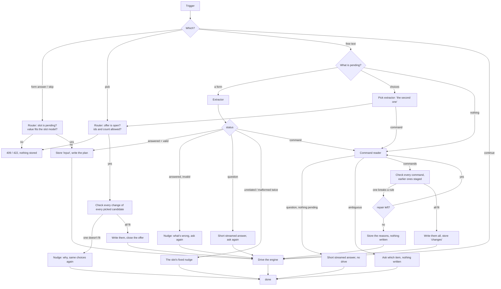
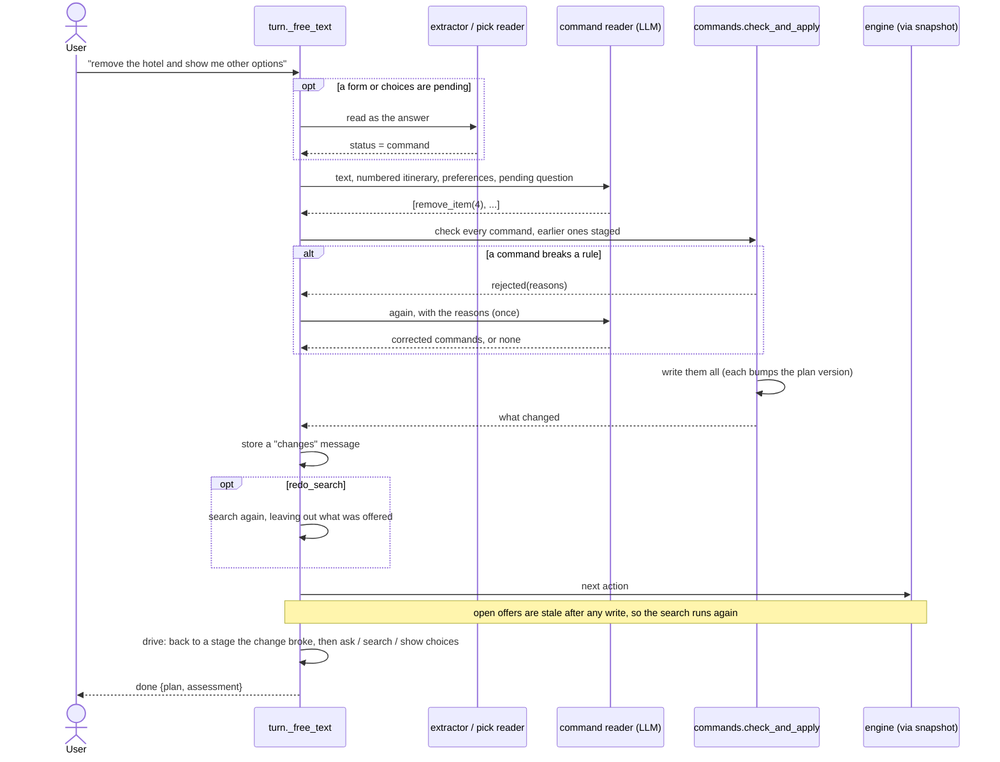

# User Flow: Form or Pick → Engine → Search → Choices

How a trip gets planned, from the user's point of view, and every rule that decides what
happens next. The short version: the **rules engine** reads the plan and says what to ask
next; the user answers a form or picks from a list; picking **is** the approval, so the pick
is checked and written straight away; and a finished stage moves on by itself. The model
never decides anything. It only reads free text into the question being asked, turns an edit
request into typed commands that the rules then check, and answers short questions.

- [1. The big picture (sequence)](#1-the-big-picture-sequence)
- [2. One turn (flowchart)](#2-one-turn-flowchart)
- [3. What each stage asks](#3-what-each-stage-asks)
- [4. Free text](#4-free-text)
- [5. Picking](#5-picking)
- [6. Moving between stages](#6-moving-between-stages)
- [7. What the user sees](#7-what-the-user-sees)

Source of truth: [engine.py](backend/src/features/planning/engine.py),
[slots.py](backend/src/features/planning/slots.py),
[turn.py](backend/src/features/planning/turn.py),
[router.py](backend/src/features/planning/router.py),
[extractor.py](backend/src/features/planning/extractor.py),
[picks.py](backend/src/features/planning/picks.py),
[commands.py](backend/src/features/planning/commands.py),
[searches.py](backend/src/features/planning/searches.py),
[tools.py](backend/src/features/chat/tools.py),
[planningTurn.ts](frontend/src/lib/planningTurn.ts),
[PlanningPanel.tsx](frontend/src/components/PlanningPanel/PlanningPanel.tsx).

---

## 1. The big picture (sequence)

Every turn is one POST that streams server-sent events. A form answer or a pick
(`POST /plans/{id}/planning/inputs`) never reaches the model. Free text
(`POST /plans/{id}/planning/chat`) reaches it as an extractor with a fixed JSON schema;
when that says the text is an edit, the command reader turns it into commands (once more to
repair them if they break a rule). A question gets a short streamed answer.

```mermaid
sequenceDiagram
    actor U as User
    participant UI as PlanningPanel
    participant R as planning router
    participant T as turn.run_turn
    participant E as engine.evaluate
    participant S as searches
    participant M as LLM (Claude)

    U->>UI: fill the form / pick / type / Continue
    UI->>R: POST inputs | chat | continue (SSE)
    R->>E: is this what is being asked?
    alt not the pending slot or offer
        R-->>UI: 409 (stale) / 422 (bad value)
    else
        R->>T: trigger
        T->>T: store the user's message (input / pick / text)
        opt free text
            T->>M: extract into the slot's schema (format=…, think=False)
            M-->>T: {status, value}
            opt status = command (or nothing pending)
                T->>M: read commands (numbered itinerary, closed command list)
                M-->>T: {status, commands}
            end
        end
        T->>T: write the answer, pick or commands to the plan
        loop drive: snapshot → evaluate → act
            T->>E: next action?
            alt AdvanceStage / ReturnToStage
                T->>T: set the stage, store a divider
            else RunSearch
                T->>S: search (flights / hotels / places / transfer rules)
                S-->>T: candidates → open an offer
            else AskInput / OfferChoice
                T-->>UI: message (the form or the choices); stop
            else Complete
                T-->>UI: stop
            end
        end
        T-->>UI: done {plan, assessment}
    end
```

## 2. One turn (flowchart)



Notes:

- The drive loop runs at most one search per turn. If it fails, a notice is stored and the
  next action stays a search, so the stage bar offers **Retry** (`POST /continue`).
- A form or choices list is stored as a message only once: a retry or a reload never repeats
  the same question.
- **More options** under a list (`POST /continue` with `refresh`) runs its search again,
  leaving out everything already offered for it since the plan last changed, and lists the
  next best. When nothing new turns up, or the search fails, the current list stays with a
  note. Transfers have no More options: the rules list every way across at once.
- Offers are persisted. An offer whose slot, stage, plan version, gap or nights no longer
  match is ignored, so any change to the plan makes the next search run again.

## 3. What each stage asks

The first rule that fires wins. A later stage first re-asks any basics it depends on (no
flight search without dates), then goes back to any earlier stage whose checklist has an
issue again (section 6).

| Stage | Asks, in order |
|---|---|
| Basics | destination → dates → travelers → origin (prefilled from home) → budget (optional, Skip) |
| Flights | flight preferences → pick a flight out → pick a flight home (priced as the round trip); or **Skip flights** |
| Lodging | lodging preferences → for each run of nights without a stay: pick a place to stay |
| Activities | interests (1–5) → pick activities (at least one); the scheduler puts them in free time |
| Transfers | for each gap between two places: pick a way to get there (taxi, train, shuttle…). Leaving home on a trip without flights, **Your car** comes first; once the trip has a car (your own, or a rental picked up after landing), it comes first for every later gap until a flight leaves it behind, priced as fuel and parking, and no second rental is offered |
| Review | nothing: the trip is complete; blocking issues from earlier stages are listed |

Preferences (cabin, stops, hotel class, interests…) are stored on the plan, not as items.
Skipping an optional input records it as declined, so it isn't asked again.

## 4. Free text

The composer always works. What it does depends on what is pending:

| Pending | Free text is read as | Outcome |
|---|---|---|
| A form | the slot's value (extractor) | answered: stored as "Got it: …" and written; invalid: a nudge saying why; a question: a short answer, then the form again; anything else: the slot's fixed nudge |
| Choices | a pick ("the second one") | as for a form, but the answer is a pick |
| Nothing (a search to run, the trip done) | an edit, or else a question about the trip | an edit as below; a question gets a short answer and nothing else runs, so it never sets off a paid search |
| Any of the above | an edit: remove, move or rename an item, change the basics or the search preferences, other options, go back, skip flights | the command reader turns it into commands; written all or nothing, shown as a "Trip updated" card, then the engine drives on from the changed plan |

The extractor asks for one small schema (`{status, value}`), with `think=False` and two
attempts. Malformed JSON twice counts as unrelated, so the user gets the deterministic
nudge rather than a guess. The answer to a question is shown and stored but never parsed.

### Edits

When the extractor or the pick reader says the text is an edit (or nothing is pending), the
**command reader** reads it against the itinerary, numbered one item per line, and replies
with commands from a closed list ([schemas.py](backend/src/features/planning/schemas.py)):

| Command | Does | Checked by |
|---|---|---|
| `remove_item` | deletes an item, with the rides straight to and from it | route, overnight, timezone and budget rules (`chat/tools.py`) |
| `update_item` | changes an item's title, times, notes or status; never its cost, places or airports | the same rules |
| `set_dates`, `set_travelers`, `set_destination`, `set_origin`, `set_budget` | changes one of the basics | the basics form's rules ("can't start in the past") |
| `set_flight_preferences`, `set_lodging_preferences`, `set_activity_preferences` | changes only the fields given of that stage's preferences | the preferences form's rules (1–5 interests) |
| `change_stage` | goes back a stage, to an earlier stage, or skips flights | the stepper's rules |
| `redo_search` | other options than the choices on show, as **More options** | only while that stage's choices are pending |

Each command changes one thing, and a field is required wherever its value is always known
(a budget's currency, the number of children). That keeps the schema within Claude's
structured-output limits (24 optional fields, 16 unions across the whole schema), which a
test holds every schema to; every command's `type` also comes first, since Claude writes
keys in schema order.

There is no command to add an item: flights, stays and activities come from searches, so
"add a museum" is at most a change to the activity interests, and the user picks from what
the search finds. Up to five commands per message; when the words could mean more than one
item, the reader asks which instead of guessing, and the reply is read together with the
question.



After the write, the "Trip updated" card names what the edit left to fix, with how: a
flight, a stay or the activities the trip no longer has ("The trip needs a flight home now.
Pick another flight, tell me what you'd like instead, or skip flights if you'll get there
another way."), or else each ride now missing ("Nothing gets you from the museum to lunch
now. …"; before ground transport, it says the ride will be looked for there). Rides aren't
named when a flight or stay is missing too, since replacing it moves them. Only stages the
plan has reached count: a later stage asks for its own.

Then the turn drives as after any answer, so the planner asks for the fix: removing the
only stay at review goes back to lodging with a divider ("Back to lodging: the trip still
needs a place to stay …") and lists stays, where the user can pick one, type what they'd
like instead, or ask for other options. A new preference searches the pending choices
again, and going back to a finished stage waits there with Continue rather than moving
straight on.

### Removing from the itinerary

Every item on the timeline (a flight, a stay, an activity, a ride) opens a sheet with
**Remove from trip**. After a confirm, it runs as a turn in the chat
(`POST /plans/{id}/planning/removals`, no model call): the `remove_item` command a typed
"remove the hotel" becomes, so the same rules, the same rides going with it, the same card
and the same walk-back as above. The user's bubble reads "Remove “Hotel Okura”."

## 5. Picking

Each candidate carries the plan changes picking it makes (`add_flight`, `add_lodging`,
`add_activity`, `add_transfer`, and `update_item` for a round-trip fare). On a pick:

1. Every change is checked against the plan with the earlier changes of the same pick
   counted: dates not in the past, lodging is overnight, the item is in the timezone the
   traveller is in then, flights follow on from each other, and the trip stays within its
   budget and per-person limits.
2. If any change doesn't fit, nothing is written and the reason is shown as a nudge; the
   same choices stay open.
3. Otherwise every change is written, the offer is closed, and (for a flight out) the token
   that lists its flights home is kept for the next search.

## 6. Moving between stages

- A stage whose checklist is complete **advances by itself**; a "Basics done. Next up:
  flights." divider marks it in the transcript.
- **Back** and the stepper's earlier steps go back a stage; later steps are locked. Going
  back keeps what was planned, and the engine picks up where it left off.
- A stage can only be left once its checklist is empty, so an issue in an earlier stage can
  only come from a later change: a stay removed at the ground stage leaves nights
  uncovered. The engine then **goes back by itself** to the earliest such stage, with a
  "Back to lodging: the trip still needs a place to stay the night of May 2." divider, and
  asks that stage's question. Basics are the exception: a missing basic is re-asked in
  place, whatever the stage. When the change happened outside a turn (the items API), the
  stage bar shows **Back to Lodging** and the next turn does it.
- **Skip flights** marks the flights stage skipped and moves on to lodging.
- The issues flyout at the end of the stepper lists timeline warnings and what the trip is
  missing in the stages reached so far, the current stage included (a ride removed since),
  but not the basics while their form is open. An issue from an earlier stage has **Go to**
  the stage that fixes it.

## 7. What the user sees

| Message kind | Shown as |
|---|---|
| `expected_input` | the planner's question, with its form under the transcript |
| `choices` | the planner's question, with the candidate cards under the transcript |
| `input` / `pick` / `message` (user) | a bubble on the right: the answer, the pick, or the typed text |
| `message` (assistant) | a bubble on the left: "Got it: …" or a short answer |
| `nudge` | a soft hint card pointing back to the question |
| `stage` | a divider between stages |
| `error` | a notice (a failed search, the model unavailable) |

While a turn runs, the panel shows what the planner is doing ("Find flights out…"), the
streamed answer to a question, or typing dots, and the stepper and issues are disabled.
Each `plan_updated` event redraws the timeline straight away.
