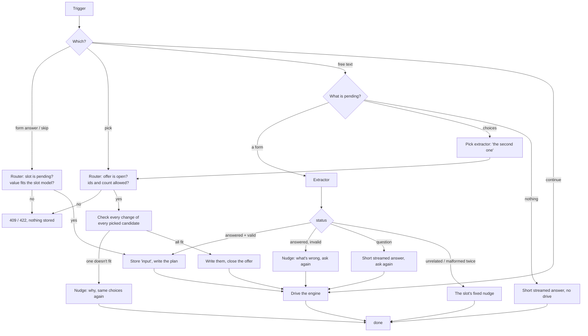

# User Flow: Form or Pick → Engine → Search → Choices

How a trip gets planned, from the user's point of view, and every rule that decides what
happens next. The short version: the **rules engine** reads the plan and says what to ask
next; the user answers a form or picks from a list; picking **is** the approval, so the pick
is checked and written straight away; and a finished stage moves on by itself. The model
never decides anything. It only reads free text into the question being asked, and answers
short questions.

- [1. The big picture (sequence)](#1-the-big-picture-sequence)
- [2. One turn (flowchart)](#2-one-turn-flowchart)
- [3. What each stage asks](#3-what-each-stage-asks)
- [4. Free text](#4-free-text)
- [5. Picking](#5-picking)
- [6. Moving between stages](#6-moving-between-stages)
- [7. What the user sees](#7-what-the-user-sees)

Source of truth: [engine.py](backend/src/features/planning/engine.py),
[slots.py](backend/src/features/planning/slots.py),
[turn.py](backend/src/features/planning/turn.py),
[router.py](backend/src/features/planning/router.py),
[extractor.py](backend/src/features/planning/extractor.py),
[picks.py](backend/src/features/planning/picks.py),
[searches.py](backend/src/features/planning/searches.py),
[tools.py](backend/src/features/chat/tools.py),
[planningTurn.ts](frontend/src/lib/planningTurn.ts),
[PlanningPanel.tsx](frontend/src/components/PlanningPanel/PlanningPanel.tsx).

---

## 1. The big picture (sequence)

Every turn is one POST that streams server-sent events. A form answer or a pick
(`POST /plans/{id}/planning/inputs`) never reaches the model. Free text
(`POST /plans/{id}/planning/chat`) reaches it once, as an extractor with a fixed JSON
schema, or as a short answer to a question.

```mermaid
sequenceDiagram
    actor U as User
    participant UI as PlanningPanel
    participant R as planning router
    participant T as turn.run_turn
    participant E as engine.evaluate
    participant S as searches
    participant M as Ollama

    U->>UI: fill the form / pick / type / Continue
    UI->>R: POST inputs | chat | continue (SSE)
    R->>E: is this what is being asked?
    alt not the pending slot or offer
        R-->>UI: 409 (stale) / 422 (bad value)
    else
        R->>T: trigger
        T->>T: store the user's message (input / pick / text)
        opt free text
            T->>M: extract into the slot's schema (format=…, think=False)
            M-->>T: {status, value}
        end
        T->>T: write the answer or pick to the plan
        loop drive: snapshot → evaluate → act
            T->>E: next action?
            alt AdvanceStage
                T->>T: set the stage, store a divider
            else RunSearch
                T->>S: search (flights / hotels / places / transfer rules)
                S-->>T: candidates → open an offer
            else AskInput / OfferChoice
                T-->>UI: message (the form or the choices); stop
            else Complete
                T-->>UI: stop
            end
        end
        T-->>UI: done {plan, assessment}
    end
```

## 2. One turn (flowchart)



Notes:

- The drive loop runs at most one search per turn. If it fails, a notice is stored and the
  next action stays a search, so the stage bar offers **Retry** (`POST /continue`).
- A form or choices list is stored as a message only once: a retry or a reload never repeats
  the same question.
- **More options** under a list (`POST /continue` with `refresh`) runs its search again,
  leaving out everything already offered for it since the plan last changed, and lists the
  next best. When nothing new turns up, or the search fails, the current list stays with a
  note. Transfers have no More options: the rules list every way across at once.
- Offers are persisted. An offer whose slot, stage, plan version, gap or nights no longer
  match is ignored, so any change to the plan makes the next search run again.

## 3. What each stage asks

The first rule that fires wins. A later stage first re-asks any basics it depends on (no
flight search without dates).

| Stage | Asks, in order |
|---|---|
| Basics | destination → dates → travelers → origin (prefilled from home) → budget (optional, Skip) |
| Flights | flight preferences → pick a flight out → pick a flight home (priced as the round trip); or **Skip flights** |
| Lodging | lodging preferences → for each run of nights without a stay: pick a place to stay |
| Activities | interests (1–5) → pick activities (at least one); the scheduler puts them in free time |
| Transfers | for each gap between two places: pick a way to get there (taxi, train, shuttle…) |
| Review | nothing: the trip is complete; blocking issues from earlier stages are listed |

Preferences (cabin, stops, hotel class, interests…) are stored on the plan, not as items.
Skipping an optional input records it as declined, so it isn't asked again.

## 4. Free text

The composer always works. What it does depends on what is pending:

| Pending | Free text is read as | Outcome |
|---|---|---|
| A form | the slot's value (extractor) | answered: stored as "Got it: …" and written; invalid: a nudge saying why; a question: a short answer, then the form again; anything else: the slot's fixed nudge |
| Choices | a pick ("the second one") | as for a form, but the answer is a pick |
| Nothing (a search to run, the trip done) | a question about the trip | a short answer; nothing else runs, so a question never sets off a paid search |

The extractor asks for one small schema (`{status, value}`), with `think=False` and two
attempts. Malformed JSON twice counts as unrelated, so the user gets the deterministic
nudge rather than a guess. Nothing else reads model output, and the answer to a question is
shown and stored but never parsed.

## 5. Picking

Each candidate carries the plan changes picking it makes (`add_flight`, `add_lodging`,
`add_activity`, `add_transfer`, and `update_item` for a round-trip fare). On a pick:

1. Every change is checked against the plan with the earlier changes of the same pick
   counted: dates not in the past, lodging is overnight, the item is in the timezone the
   traveller is in then, flights follow on from each other, and the trip stays within its
   budget and per-person limits.
2. If any change doesn't fit, nothing is written and the reason is shown as a nudge; the
   same choices stay open.
3. Otherwise every change is written, the offer is closed, and (for a flight out) the token
   that lists its flights home is kept for the next search.

## 6. Moving between stages

- A stage whose checklist is complete **advances by itself**; a "Basics done. Next up:
  flights." divider marks it in the transcript.
- **Back** and the stepper's earlier steps go back a stage; later steps are locked. Going
  back keeps what was planned, and the engine picks up where it left off.
- **Skip flights** marks the flights stage skipped and moves on to lodging.
- The issues flyout at the end of the stepper lists blocking issues and timeline warnings,
  each with **Go to** the stage that fixes it.

## 7. What the user sees

| Message kind | Shown as |
|---|---|
| `expected_input` | the planner's question, with its form under the transcript |
| `choices` | the planner's question, with the candidate cards under the transcript |
| `input` / `pick` / `message` (user) | a bubble on the right: the answer, the pick, or the typed text |
| `message` (assistant) | a bubble on the left: "Got it: …" or a short answer |
| `nudge` | a soft hint card pointing back to the question |
| `stage` | a divider between stages |
| `error` | a notice (a failed search, the model unavailable) |

While a turn runs, the panel shows what the planner is doing ("Find flights out…"), the
streamed answer to a question, or typing dots, and the stepper and issues are disabled.
Each `plan_updated` event redraws the timeline straight away.
